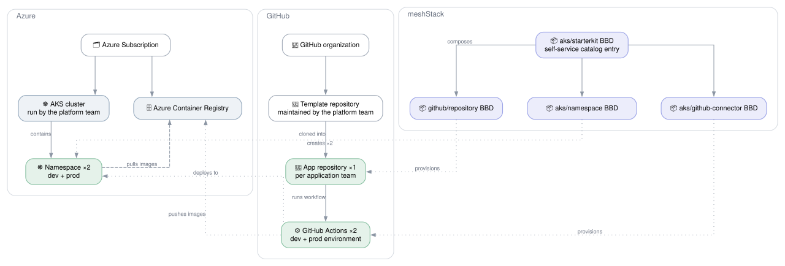

# Azure Kubernetes Platform

## Overview

The **Azure Kubernetes Platform** reference architecture delivers a self-service Kubernetes
experience on Azure from four Hub building blocks. Application teams go from "I need a place to run
my app" to "my code is deployed" in minutes, without filing tickets.

Every building block runs at **workspace level**. There is no meshStack project, tenant, platform
or landing zone in this architecture: a namespace is a building block, not a tenant. The platform
team still operates the AKS cluster; this architecture layers developer self-service on top of it.

**Target audience:**

- **Platform engineers** who already have an AKS cluster and want to add self-service onboarding.
- **Application teams** who need a fast, secure path to Kubernetes with built-in CI/CD.

## Architecture Diagram

## How It Works

### 1. Developer Starterkit: `aks/starterkit`

The starterkit is a **building block composition** that application teams order from the
self-service catalog. When a developer clicks "Order", it:

1. Creates a **GitHub repository** from a configurable template (`github/repository`).
2. Creates a **dev** and a **prod** namespace (`azure/aks-namespace`).
3. Wires each namespace to the repository with a **GitHub Actions connector**
   (`aks/github-connector`). Dev deploys from `main`, prod from `release`.

Each connector is ordered with the repository and its namespace as parent building blocks, and
reads the namespace name from the namespace block's output.

### 2. Namespace: `azure/aks-namespace`

Creates the namespace on the platform team's cluster, with:

- a `ResourceQuota` and a `LimitRange` with default container requests and limits
- an Entra group per namespace role (`admin`, `edit`, `view`), filled from the workspace's members
  by their workspace role (owner and manager, member, reader), and bound to the matching cluster role.
  Existing groups can be added alongside
- the owning workspace recorded as a label

The block runs as a user-assigned managed identity that meshStack's building block runner federates
into. It holds no kubeconfig. The identity has cluster admin on the one cluster through Azure RBAC
for Kubernetes, and Microsoft Graph `User.Read.All` and `Group.ReadWrite.All` to manage the groups. If you set `acr_id` on its backplane, the cluster's kubelet identity also gets
`AcrPull` on your Azure Container Registry, so no namespace needs an image pull secret.

### 3. GitHub Repository: `github/repository`

Each application team gets its own repository with a predefined structure (Dockerfile, Kubernetes
manifests, GitHub Actions workflow), branch protection and team-based access control.

### 4. CI/CD Pipeline: `aks/github-connector`

The connector creates a **Kubernetes service account** scoped to the target namespace, **GitHub
Actions environment secrets** for cluster and container registry access, and a workflow that
builds, scans and deploys on every push.

## Getting Started

### Prerequisites

| Requirement | Description |
|---|---|
| meshStack instance | With the OpenTofu building block runner configured. |
| AKS cluster | Entra-integrated, with Azure RBAC for Kubernetes authorization enabled, and reachable from the runner. |
| Azure Container Registry | Optional. Pass its resource ID to the `azure/aks-namespace` backplane. |
| GitHub organization | With a GitHub App installed for the Terraform GitHub provider. |

### Deployment order

1. Deploy `azure/aks-namespace` and note its `building_block_definition` output.
2. Deploy `github/repository`.
3. Deploy `aks/github-connector`, passing the namespace definition's UUID as
   `aks.namespace_definition_uuid`.
4. Deploy `aks/starterkit`, passing the three definition versions in
   `building_block_definition_version_refs` under the keys `git-repository`, `aks-namespace` and
   `github-actions-connector`.

## Shared Responsibilities

| Responsibility | Platform Team | Application Team |
| --- | --- | --- |
| Provision and manage the AKS cluster | ✅ | ❌ |
| Register and maintain building block definitions | ✅ | ❌ |
| Set up the namespace backplane identity and permissions | ✅ | ❌ |
| Configure GitHub App & template repositories | ✅ | ❌ |
| Grant the namespace backplane its Microsoft Graph permissions (admin consent) | ✅ | ❌ |
| Manage workspace members and their roles | ❌ | ✅ |
| Order starterkit from the self-service catalog | ❌ | ✅ |
| Develop and maintain application source code | ❌ | ✅ |
| Manage Kubernetes resources inside namespaces | ❌ | ✅ |
| Merge to release branch for production deployments | ❌ | ✅ |
| Monitor application health and logs | ❌ | ✅ |
