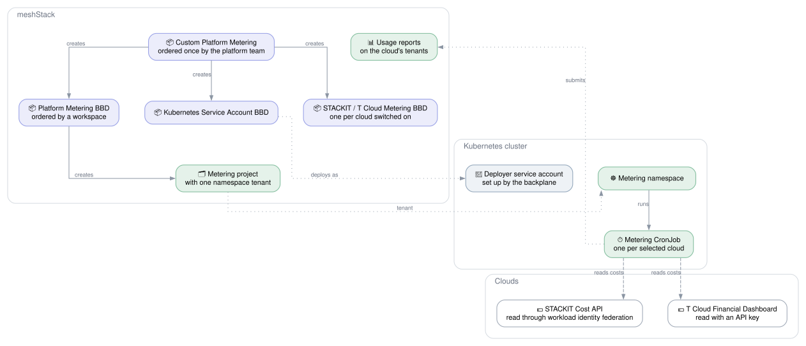

# Custom Platform Metering

meshStack meters the large hyperscalers natively. For other clouds it imports usage reports, which a
job has to collect from the cloud's cost API. This architecture runs those jobs from
[mesh-custom-metering](https://github.com/meshcloud/mesh-custom-metering) on a Kubernetes cluster
that is already a platform in meshStack, so there is no separate infrastructure to operate.

## How it works

1. **The platform team orders Custom Platform Metering once.** The order form asks for the
   Kubernetes platform and an admin kubeconfig of its cluster, the meshStack API user the reports are
   submitted with, and a switch per cloud with that cloud's settings and credentials.
2. **The run creates the definitions.** It creates the Kubernetes Service Account definition with a
   deployer identity on the cluster, one metering definition per cloud that is switched on, and the
   **Platform Metering** definition that orders them.
3. **A workspace orders Platform Metering and ticks the clouds.** That creates a project with one
   namespace, a service account allowed to deploy only into it, and one metering CronJob per cloud.
4. **The CronJobs submit usage reports every hour.** Each run re-submits the full current month, and
   the costs show up on the tenants of the cloud's meshPlatform.

Adding a cloud later is editing the Custom Platform Metering block: switch the cloud on, run it, and
it shows up on the Platform Metering order form.

## Credentials

| Credential | Used for | Stored in meshStack as |
|---|---|---|
| Admin kubeconfig | Creating the deployer identity on the cluster | Sensitive input of Custom Platform Metering only |
| meshStack API user | Submitting usage reports; the metering API accepts no API keys | Sensitive input of every metering definition |
| STACKIT service account key | Creating the STACKIT metering identities | Sensitive input of Custom Platform Metering only |
| T Cloud Financial Dashboard API key | Reading T Cloud consumption; valid for at most 90 days | Sensitive input of the T Cloud metering definition |

The STACKIT metering jobs hold no STACKIT key: they read the costs through workload identity
federation with the token of their Kubernetes service account.

## Getting Started

**Prerequisites**

- A Kubernetes platform in meshStack with a landing zone, and an admin kubeconfig of its cluster.
- A meshStack API user, created by an organization admin in meshPanel.
- For STACKIT: a STACKIT meshPlatform, a project for the metering service accounts, a service
  account key with the rights to create service accounts there and assign roles on the
  organization, and the OIDC issuer of the cluster from its `/.well-known/openid-configuration`.
  STACKIT must reach that issuer.
- For T Cloud Public: a T Cloud meshPlatform and a Financial Dashboard API key with security level
  `Admin`.
- A building block runner that offers a token for Azure, which the STACKIT metering uses as a generic
  OIDC token. The default runner does.

**Deployment**

1. Apply `meshstack_integration.tf` with your `meshstack` and `hub` values. It creates the Custom
   Platform Metering definition in your platform workspace.
2. Order Custom Platform Metering in that workspace and fill in the form.
3. Order Platform Metering in the workspace that should hold the metering jobs, and tick the clouds.

## Shared Responsibility

| Responsibility | Platform Team | Application Team |
|---|:---:|:---:|
| Operate the Kubernetes cluster | ✅ | ❌ |
| Provide the meshStack API user and the cloud credentials | ✅ | ❌ |
| Rotate the T Cloud Financial Dashboard API key | ✅ | ❌ |
| Publish the metering images | ✅ | ❌ |
| Choose which clouds a workspace meters | ❌ | ✅ |
| Monitor failed metering runs | ❌ | ✅ |
