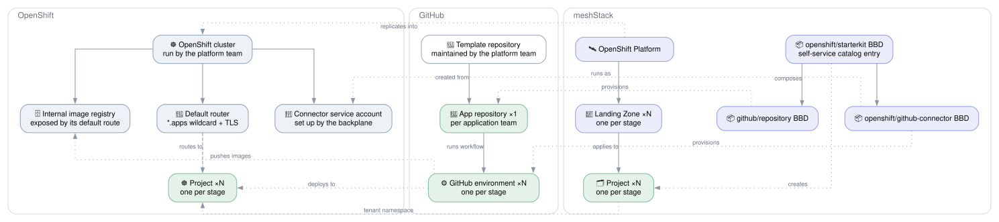

# OpenShift Kubernetes Platform

## Overview

The **OpenShift Kubernetes Platform** reference architecture adds developer self-service on top
of an OpenShift cluster the platform team already operates. An application team orders one
starterkit from the meshStack catalog and gets everything it needs to go from an empty repository
to a running application: an OpenShift project per stage, a GitHub repository with a ready
pipeline, and the credentials that let that pipeline deploy into exactly those projects.

It builds on what OpenShift ships with instead of adding services next to it:

- Images go to the cluster's **internal image registry**. The pipeline pushes into the image
  streams of its own project, and pods pull from there without a pull secret.
- Applications are exposed through the **default router** and its `*.apps` wildcard certificate,
  so a route needs no certificate management of its own.
- Workloads run under the **`restricted-v2` security context constraint**, which the template
  repository has to honour.

**Target audience:**

- **Platform engineers** who run OpenShift and want to offer onboarding without tickets.
- **Application teams** who want a fast, secure path to OpenShift with built-in CI/CD.

## Architecture Diagram

## How It Works

### 1. Developer Starterkit — `openshift/starterkit`

The starterkit is a **meshStack building block composition** that application teams order from
the self-service catalog. The platform's landing zones decide the stages — typically `dev` and
`prod`. For one order, the starterkit:

1. Creates a **GitHub repository** from the template repository (`github/repository`).
2. Creates **one meshStack project per stage**, each with an OpenShift tenant in that stage's
   landing zone. meshStack's replication creates the OpenShift project.
3. Orders a **GitHub Actions connector** (`openshift/github-connector`) on every tenant, wired to
   the repository's GitHub environment of the same name.
4. Grants the requesting developer **Project Admin** on every project.

Every stage gets a hostname under the cluster's apps domain, `<name>-<stage>.apps…` and
`<name>.apps…` for `prod`. `prod` deploys from the `release` branch, every other stage from `main`.

### 2. GitHub Repository — `github/repository`

Each application gets its own private repository, created from a template the platform team
maintains. The template carries the Dockerfile, the manifests and the GitHub Actions workflow.

### 3. CI/CD Connector — `openshift/github-connector`

The connector runs as a dedicated service account that its backplane sets up once per cluster. That
account may only manage service accounts, secrets and role bindings, and bind exactly the `edit` and
`system:image-builder` cluster roles. On each tenant the connector creates:

- A **`github-actions` service account** in the project, bound to `edit` and `system:image-builder`
  there and nowhere else.
- A **GitHub environment** holding its kubeconfig and registry token as secrets, and the project
  name, the registry host and the app hostname as variables.

Separate environments per stage keep dev credentials out of production, and GitHub's environment
protection rules can gate production deployments further.

## Getting Started

### Prerequisites

| Requirement | Description |
|---|---|
| meshStack instance | With the OpenTofu building block runtime. |
| OpenShift platform | An OpenShift cluster integrated into meshStack as a platform, with one landing zone per stage. |
| Image registry route | The internal registry exposed through its default route. |
| GitHub organization | With a GitHub App installed for the GitHub Terraform provider. |
| Template repository | A GitHub template repository with Dockerfile, manifests and a workflow that uses the environment's `KUBECONFIG`, `OPENSHIFT_REGISTRY_TOKEN`, `OPENSHIFT_NAMESPACE`, `OPENSHIFT_REGISTRY` and `APP_HOSTNAME`. |

### Deployment order

1. Deploy the `github/repository` integration and note its definition.
2. Deploy the `openshift/github-connector` integration with a `kubernetes` provider configured as
   cluster admin. Its backplane creates the connector's service account.
3. Deploy the `openshift/starterkit` integration with the platform's `ref`, the landing zone refs
   per stage and the version refs of both definitions above.
4. Publish the starterkit in the marketplace.

## Shared Responsibilities

| Responsibility | Platform Team | Application Team |
|---|:---:|:---:|
| Operate the OpenShift cluster, router and internal registry | ✅ | ❌ |
| Register and maintain the building block definitions | ✅ | ❌ |
| Configure the GitHub App and maintain the template repository | ✅ | ❌ |
| Order the starterkit from the self-service catalog | ❌ | ✅ |
| Develop and maintain the application source code | ❌ | ✅ |
| Manage Kubernetes resources inside the projects | ❌ | ✅ |
| Merge to the release branch for production deployments | ❌ | ✅ |
| Monitor application health and logs | ❌ | ✅ |
