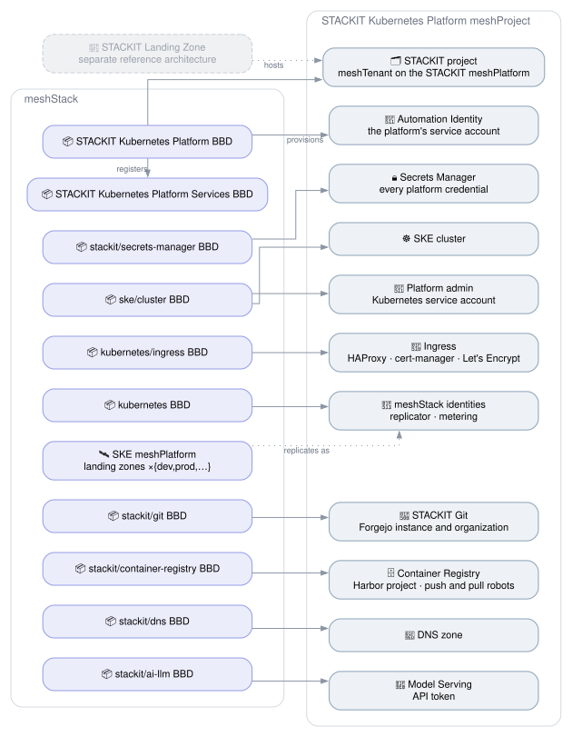
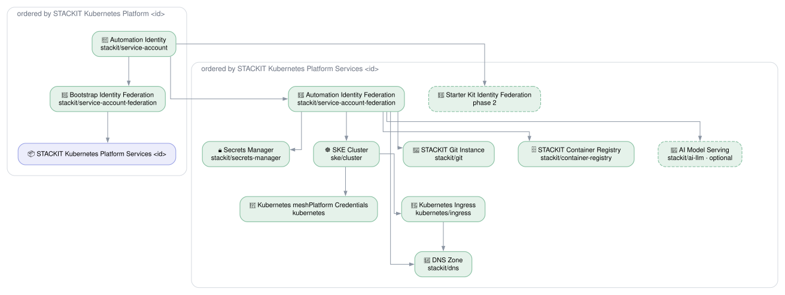
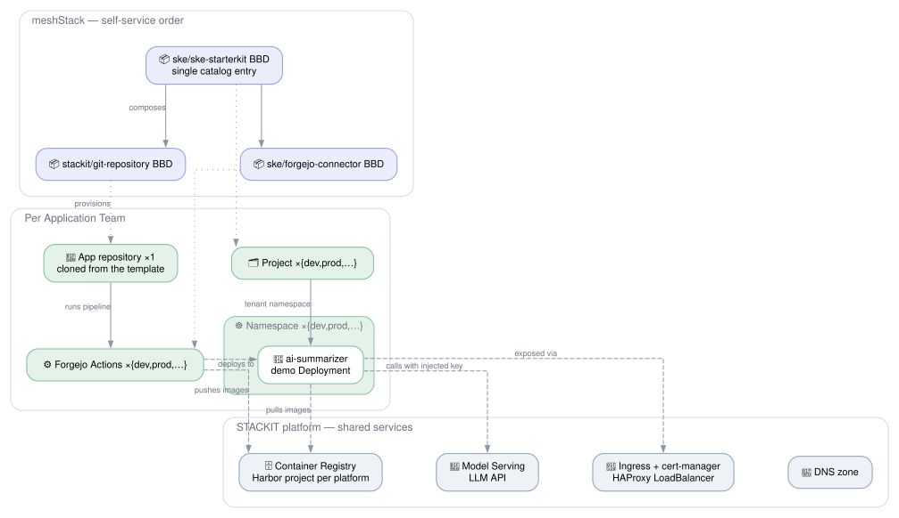

# STACKIT Kubernetes Platform

## Overview

This reference architecture builds a STACKIT Kubernetes Engine (SKE) platform on top of the
STACKIT Landing Zone reference architecture. The SKE platform offers application teams a starter
kit that deploys the ai-summarizer demo app with a dev and a prod stage by default.

Every STACKIT resource is created by a building block that acts as the platform's one STACKIT
service account through workload identity federation. All platform credentials are stored in the
platform's STACKIT Secrets Manager.

## Architecture

### Platform team

The platform team orders the **STACKIT Kubernetes Platform** building block once. The definitions
it registers and what each provisions:



The building blocks Platform Services orders, with their parents as meshPanel shows them:



### Application teams



## How It Works

### Starter kit — `ske/ske-starterkit`

The one definition application teams order. It creates:

1. a Git repository (`stackit/git-repository`), cloned from the template repository, with the
   image name as the `APP_NAME` Actions variable,
2. one meshProject per stage, each with an SKE tenant on that stage's landing zone (`dev` and
   `prod` by default),
3. one Forgejo connector (`ske/forgejo-connector`) per stage,
4. a Project Admin binding on every project for the user who ordered it.

### Git repository — `stackit/git-repository`

- Forgejo teams from the workspace members: Workspace Owner → `admins`, Workspace Manager →
  `writers`, everyone else → `readers`.
- Actions secrets `HARBOR_REGISTRY`, `HARBOR_USERNAME` and `HARBOR_PASSWORD`: the push robot.
- Actions variables `HARBOR_REGISTRY` and `HARBOR_PROJECT`.

### Forgejo connector — `ske/forgejo-connector`

Per stage:

- a Kubernetes service account with RBAC on the namespace and read access to ClusterIssuers,
- a Harbor image pull secret on the namespace's `default` service account,
- a `stackit-ai` secret with `STACKIT_AI_BASE_URL`, `STACKIT_AI_API_KEY` and `STACKIT_AI_MODEL`,
  unless **Starter Kit Demo** names no `ai_model`,
- the Actions secret `KUBECONFIG_<STAGE>` and the Actions variables `K8S_NAMESPACE_<STAGE>` and
  `APP_HOSTNAME_<STAGE>`.

Once set up, it triggers the repository's workflow and waits for it to finish.

## Getting Started

### Prerequisites

| Requirement          | Description |
|----------------------|-------------|
| meshStack instance   | With the OpenTofu IaC runtime. |
| STACKIT Landing Zone | A deployed STACKIT Landing Zone building block. Its summary shows the code block for the **STACKIT Landing Zone** input. |
| STACKIT portal       | Access to the platform's Harbor project, to link one robot account in phase 2. |

### Install

1. Register the definition from `meshstack_integration.tf` in your foundation repository.
2. Order **STACKIT Kubernetes Platform** in the workspace that will own the platform, and paste
   the landing zone's code block into **STACKIT Landing Zone**. Turn **Playground Mode** off for a
   platform that is used: in playground mode the platform identifier gets a random suffix and the
   STACKIT project is not protected against deletion. It cannot be changed after the order.
3. Finish phase 2.

The main inputs:

| Input | Purpose |
|---|---|
| STACKIT Landing Zone | Platform, landing zones and the service account and federation definitions of the landing zone |
| Landing Zone Variant | `default` or `networked` (needs hub-and-spoke networking on the landing zone) |
| Platform Identifier | Name of the meshStack platform; the project, cluster, Git instance, registry and DNS zone are named after it |
| Use Global Location | Put the platform into the global meshStack location, on by default; off creates a location for it |
| Playground Mode | Throwaway deployment, on by default; turn it off for a platform that is used; fixed at the order. It hides Starterkit Random Name Suffix (always on), DNS Domain (always `<platform identifier>.stackit.run`) and both approval policies (no gates) |
| Payment Method | One of the workspace's payment methods, for the platform's own project |
| Starter Kit Demo | What the starter kit builds: image `name`, `template_repo` and `ai_model`, `ai-summarizer` from the likvid-bank template on `openai/gpt-oss-120b` by default. Without `ai_model` the platform sets up no Model Serving token and no `stackit-ai` secret |
| DNS Domain | The platform's DNS zone under a free STACKIT domain (`stackit.run`, `stackit.zone`, `stackit.rocks`, `stackit.gg`, `runs.onstackit.cloud`): a bare one gives `<platform identifier>.stackit.run`, one label more such as `likvid.stackit.run` is the zone itself; `stackit.run` by default |
| Stages | One landing zone per named stage, with stage-specific tags and optional quotas; `dev` and `prod` by default |
| Quota Definitions | The quotas the meshPlatform offers; a stage's `quotas` entry names one by its `quota_key` |
| Tags | Tags as `{key, values}` entries for landing zones, the definitions platform engineers order (`building_block`) and those application teams order (`starterkit_building_block`), the platform's project and the starter kit's projects |
| Approval Policies, Starterkit Approval Policies | See Approval gates |
| Phase 2 Completed | See below |
| Imports | See Adopting Existing Resources |

A tag that a tag policy pairs between a landing zone and a project belongs on both sides, in
`tags.landingzone` and `tags.starterkit_project` or in a stage's `landingzone` and `project`;
otherwise no tenant can be created on the landing zone.

**Overrides** replaces generated values, each optional: `cluster_name`, `cluster_issuer_email` (the
platform's service account by default) and `project_identifier` (`<platform identifier>-ske` by
default). The building block outputs a link to the STACKIT project
and the summary of Platform Services.

### Phase 2: link the Harbor robot

Harbor accepts no STACKIT identity until a robot account is linked to it, and only the STACKIT
portal can create that link. The summary lists the steps: create a robot with robot account
management permissions and link it to the platform's service account. Then set **Phase 2
Completed** to true. The next run mints the push and pull robots and registers the **STACKIT Git
Repository**, **SKE Forgejo Connector** and **SKE Starterkit** definitions. The run fails while no
robot is linked.

### Approval gates

The **Approval Policies** input sets which run triggers need an operator's approval on the
platform definitions this architecture registers, **Starterkit Approval Policies** the same for the
Git repository, Forgejo connector and starter kit definitions. The `approval_policies` variable of
`meshstack_integration.tf` sets them for this definition. All default to no gate. A gate switched on
in meshPanel is reset on the next run unless it is set in the input or variable.

### Platform engineer access

The owners and managers of the ordering workspace become Project Admins of the platform's project.
Project Admins join the Forgejo `Owners` team (once they signed in to the Git instance), become
registry admins and get `secrets-manager.reader`, with which they read secrets using their STACKIT
access token:

```sh
export VAULT_ADDR=https://prod.sm.eu01.stackit.cloud
export VAULT_TOKEN=$(stackit auth get-access-token)
vault kv list -mount=<Secrets Manager instance id> <platform identifier>/
```

## Adopting Existing Resources

The optional **Imports** input takes over resources that already exist, for example a platform
built before this architecture:

| Key | Takes over |
|---|---|
| `project = {display_name, admin_bindings}` | the meshProject `overrides.project_identifier` and its tenant on the landing zone platform; `display_name` keeps the project's display name, `admin_bindings` maps a username to the name of its existing Project Admin binding |
| `adopt_ske = true` | the SKE cluster `overrides.cluster_name` |
| `git = {instance_id, instance_name, forgejo_organization}` | the STACKIT Git instance and its Forgejo organization |
| `dns = {zone_id, record_set_id}` | the DNS zone **DNS Domain** names and its wildcard record set |
| `adopt_ingress = true` | the namespaces `cert-manager` and `haproxy-ingress`, their Helm releases `cert-manager` and `haproxy`, and the ClusterIssuer `letsencrypt-prod` |
| `secrets_manager = {instance_id}` | the Secrets Manager instance, renamed to the platform identifier |
| `container_registry = {artifactory_id, registry_name}` | the container registry of that full name |
| `kubernetes_platform = {platform_name, location_name, landingzone_names}` | the namespace `meshcloud` and the identities `meshfed-service` and `meshfed-metering` of an earlier meshStack platform registration; `platform_name` also takes over the KUBERNETES meshPlatform of that name, and `landingzone_names` maps a stage to the name of its existing landing zone on it. `location_name` references an existing location instead of creating one; `platform_name` needs it or **Use Global Location**. All three are optional; `{}` takes over only what is in the cluster |
| `starterkit_definitions = {starterkit, git_repository, forgejo_connector}` | the existing definitions application teams order, by uuid, each optional; the platform registers its definition as a new version of each, so their building blocks upgrade to it |

Every key but `starterkit_definitions` needs `project`, because the resources live in its STACKIT project. `adopt_ingress` and
`kubernetes_platform` also need `adopt_ske`. Everything else is created new. Names the imports leave out
derive from **Platform Identifier**, so a stage added later gets `<platform identifier>-namespace-<stage>`.

With `git`, the Git building block's technical user must be in the organization's `Owners` team,
which only an owner can arrange: its first run fails until an owner adds that user, then run it
again.

The order form shows **Imports** only with playground mode off. Through the
API, a playground that takes something over leaves it in place on deletion; otherwise deletion
deletes it. A meshPlatform and definitions can only be taken over with playground mode off.

A definition is taken over in phase 2, when the platform registers it. Its latest version decides
what that run does: a draft version is overwritten, and a released one gets a new draft version
only if `hub.bbd_draft` is true. With `hub.bbd_draft = false` the run fails on a released version, so
take the definitions over with `hub.bbd_draft = true` and release afterwards. Existing building
blocks stay on their version until they are upgraded. Order with **Starterkit Random Name Suffix**
set to what the adopted starterkit used: a starterkit upgrade that changes it renames, and so
replaces, every project and tenant the starterkit created, so it cannot be changed after the order. meshStack checks the Forgejo connector's
`repository_name` input against the latest released Git repository version, so release the Git
repository's new draft by hand before the connector can be saved.

`hub.bbd_draft` decides only whether the three application team definitions are released. This
definition and the platform's own definitions are always drafts, so they stay in the owning
workspace.

The first run may change what it takes over to match this architecture's settings. To review it,
switch on the `building_block_creation` and `any_input_changes` gates in **Approval Policies** for the
adoption and off again afterwards.

## Shared Responsibilities

| Responsibility                                           | Platform Team | Application Team |
|----------------------------------------------------------| --- | --- |
| Provision and manage SKE cluster                         | ✅ | ❌ |
| Configure STACKIT Git (Forgejo) organization             | ✅ | ❌ |
| Manage the Harbor project and its robot accounts         | ✅ | ❌ |
| Register and maintain building block definitions         | ✅ | ❌ |
| Manage STACKIT DNS zone for app hostnames                | ✅ | ❌ |
| Order starterkit from the self-service catalog           | ❌ | ✅ |
| Develop and maintain application source code             | ❌ | ✅ |
| Manage Kubernetes resources inside namespaces            | ❌ | ✅ |
| Maintain Forgejo Actions pipeline (`pipeline.yaml`)      | ❌ | ✅ |
| Monitor application health and logs                      | ❌ | ✅ |
