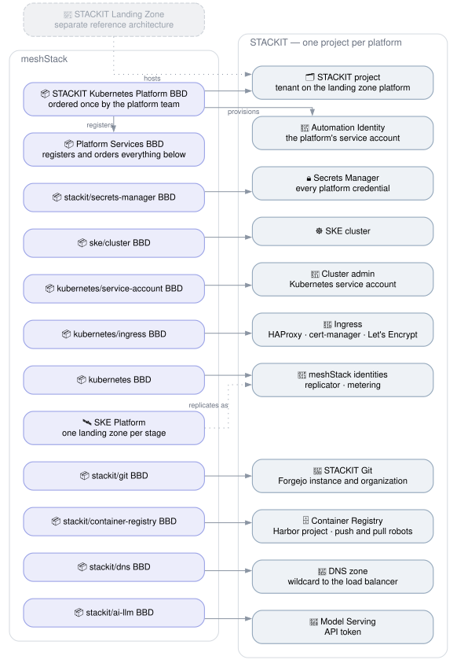
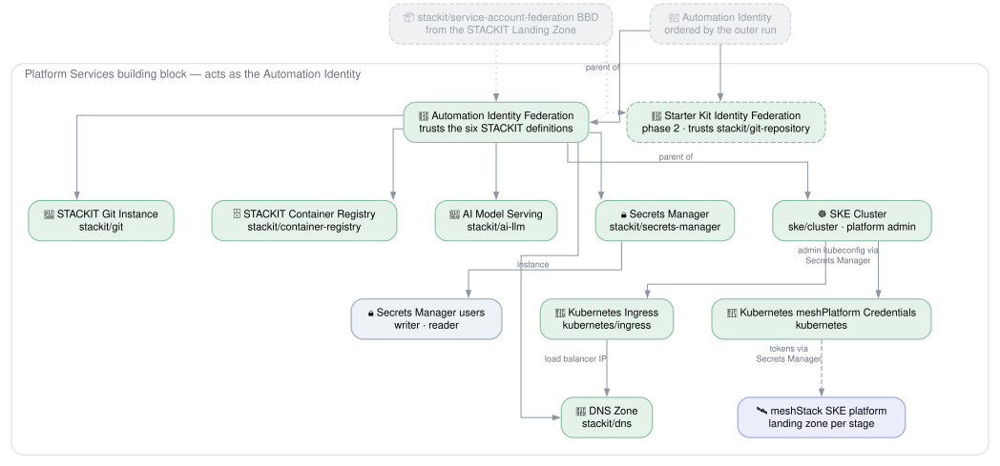
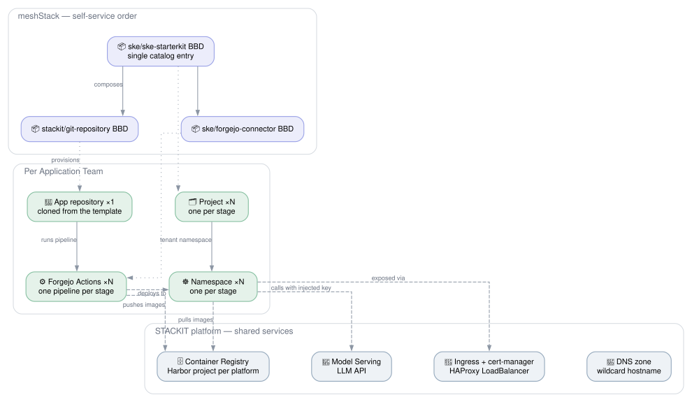

# STACKIT Kubernetes Platform

## Overview

This reference architecture builds a STACKIT Kubernetes Engine (SKE) platform on top of the
STACKIT Landing Zone reference architecture. The SKE platform offers application teams a starter
kit that deploys the ai-summarizer demo app with a dev and a prod stage by default.

Every STACKIT resource is created by a building block that acts as the platform's one STACKIT
service account through workload identity federation. All platform credentials are stored in the
platform's STACKIT Secrets Manager.

## Architecture

### Platform team

The platform team orders the **STACKIT Kubernetes Platform** building block once. The definitions
it registers and what each provisions:



The building blocks Platform Services orders, with their parents as meshPanel shows them:



### Application teams



## How It Works

### Starter kit — `ske/ske-starterkit`

The one definition application teams order. It creates:

1. a Git repository (`stackit/git-repository`), cloned from the template repository, with the
   image name as the `APP_NAME` Actions variable,
2. one meshProject per stage, each with an SKE tenant on that stage's landing zone (`dev` and
   `prod` by default),
3. one Forgejo connector (`ske/forgejo-connector`) per stage,
4. a Project Admin binding on every project for the user who ordered it.

### Git repository — `stackit/git-repository`

- Forgejo teams from the workspace members: Workspace Owner → `admins`, Workspace Manager →
  `writers`, everyone else → `readers`.
- Actions secrets `HARBOR_REGISTRY`, `HARBOR_USERNAME` and `HARBOR_PASSWORD`: the push robot.
- Actions variables `HARBOR_REGISTRY` and `HARBOR_PROJECT`.

### Forgejo connector — `ske/forgejo-connector`

Per stage:

- a Kubernetes service account with RBAC on the namespace and read access to ClusterIssuers,
- a Harbor image pull secret on the namespace's `default` service account,
- a `stackit-ai` secret with `STACKIT_AI_BASE_URL`, `STACKIT_AI_API_KEY` and `STACKIT_AI_MODEL`,
- the Actions secret `KUBECONFIG_<STAGE>` and the Actions variables `K8S_NAMESPACE_<STAGE>` and
  `APP_HOSTNAME_<STAGE>`.

Once set up, it triggers the repository's workflow and waits for it to finish.

## Getting Started

### Prerequisites

| Requirement          | Description |
|----------------------|-------------|
| meshStack instance   | With the OpenTofu IaC runtime. |
| STACKIT Landing Zone | A deployed STACKIT Landing Zone building block. Its summary shows the code block for the **STACKIT Landing Zone** input. |
| STACKIT portal       | Access to the platform's Harbor project, to link one robot account in phase 2. |

### Install

1. Register the definition from `meshstack_integration.tf` in your foundation repository. Set
   `playground_mode = false` for a platform that is used: in playground mode the platform
   identifier gets a random suffix and the STACKIT project is not protected against deletion.
2. Order **STACKIT Kubernetes Platform** in the workspace that will own the platform, and paste
   the landing zone's code block into **STACKIT Landing Zone**.
3. Finish phase 2.

The main inputs:

| Input | Purpose |
|---|---|
| STACKIT Landing Zone | Platform, landing zones and the service account and federation definitions of the landing zone |
| Landing Zone Variant | `default` or `networked` (needs hub-and-spoke networking on the landing zone) |
| Platform Identifier | Name of the meshStack platform; the project, cluster, Git instance, registry and DNS zone are named after it |
| Stages | One landing zone per key, with stage-specific tags; `dev` and `prod` by default |
| Tags | Tags for landing zones, definitions, the platform's project and the starter kit's projects |
| DNS Parent Domain | Domain the DNS zone is created under, `stackit.run` by default |
| AI Model | Model applications default to, `openai/gpt-oss-120b` by default |
| Starter Kit Image Name, Template Repository | What the starter kit builds, `ai-summarizer` from the likvid-bank template by default |
| Phase 2 Completed | See below |
| Imports, Import Secrets | See Adopting Existing Resources |

A tag that a tag policy pairs between a landing zone and a project belongs on both sides, in
`tags.landingzone` and `tags.starterkit_project` or in a stage's `landingzone` and `project`;
otherwise no tenant can be created on the landing zone.

Optional overrides: Cluster Name, ClusterIssuer Email, DNS Subdomain, Project Identifier, Payment
Method Identifier, Use Global Location. The building block outputs a link to the STACKIT project
and the summary of Platform Services.

### Phase 2: link the Harbor robot

Harbor accepts no STACKIT identity until a robot account is linked to it, and only the STACKIT
portal can create that link. The summary lists the steps: create a robot with robot account
management permissions and link it to the platform's service account. Then set **Phase 2
Completed** to true. The next run mints the push and pull robots and registers the **STACKIT Git
Repository**, **SKE Forgejo Connector** and **SKE Starterkit** definitions. The run fails while no
robot is linked.

### Approval gates

`approval_policies` sets which run triggers need an operator's approval, for this definition and
the platform definitions it registers. `starterkit_approval_policies` does the same for the Git
repository, Forgejo connector and starter kit definitions. Both default to no gate. A gate switched
on in meshPanel is reset on the next apply unless it is set here.

## Adopting Existing Resources

The optional **Imports** input takes over resources that already exist, for example a platform
built before this architecture:

| Key | Takes over |
|---|---|
| `project = {display_name, admin_bindings}` | the meshProject **Project Identifier** and its tenant on the landing zone platform; `display_name` keeps the project's display name, `admin_bindings` maps a username to the name of its existing Project Admin binding |
| `ske = {}` | the SKE cluster **Cluster Name** |
| `git = {instance_id, instance_name, forgejo_organization}` | the STACKIT Git instance and its Forgejo organization |
| `dns = {zone_id, record_set_id}` | the DNS zone **DNS Subdomain**.**DNS Parent Domain** and its wildcard record set |
| `ingress = {}` | the namespaces `cert-manager` and `haproxy-ingress`, their Helm releases `cert-manager` and `haproxy`, and the ClusterIssuer `letsencrypt-prod` |
| `secrets_manager = {instance_id}` | the Secrets Manager instance, renamed to the platform identifier |
| `container_registry = {artifactory_id, registry_name}` | the container registry of that full name |
| `kubernetes_platform = {}` | the namespace `meshcloud` and the identities `meshfed-service` and `meshfed-metering` of an earlier meshStack platform registration |

Every key needs `project`, because the resources live in its STACKIT project. `ingress` and
`kubernetes_platform` also need `ske`. Everything else is created new.

`git` also needs a Forgejo API token of an owner of the organization, in the sensitive **Import
Secrets** input:

```hcl
{
  git = { forgejo_api_token = "<token>" }
}
```

In playground mode, deleting the platform leaves what it took over in place. Otherwise it deletes
it.

The first run may change what it takes over to match this architecture's settings. To review it,
switch on the `building_block_creation` and `any_input_changes` gates in `approval_policies` for the
adoption and off again afterwards.

## Shared Responsibilities

| Responsibility                                           | Platform Team | Application Team |
|----------------------------------------------------------| --- | --- |
| Provision and manage SKE cluster                         | ✅ | ❌ |
| Configure STACKIT Git (Forgejo) organization             | ✅ | ❌ |
| Manage the Harbor project and its robot accounts         | ✅ | ❌ |
| Register and maintain building block definitions         | ✅ | ❌ |
| Manage STACKIT DNS zone for app hostnames                | ✅ | ❌ |
| Order starterkit from the self-service catalog           | ❌ | ✅ |
| Develop and maintain application source code             | ❌ | ✅ |
| Manage Kubernetes resources inside namespaces            | ❌ | ✅ |
| Maintain Forgejo Actions pipeline (`pipeline.yaml`)      | ❌ | ✅ |
| Monitor application health and logs                      | ❌ | ✅ |
