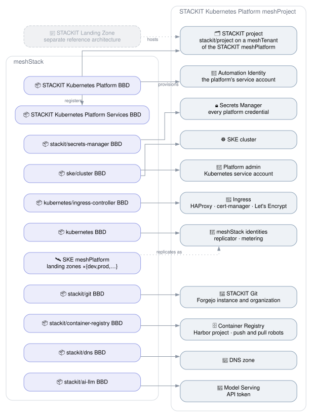
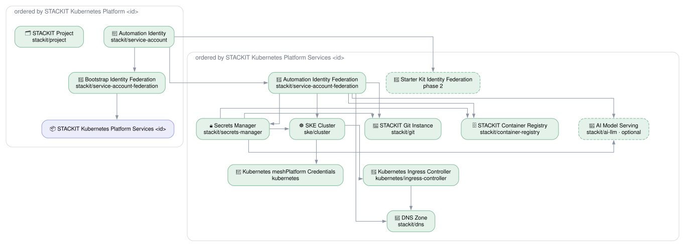
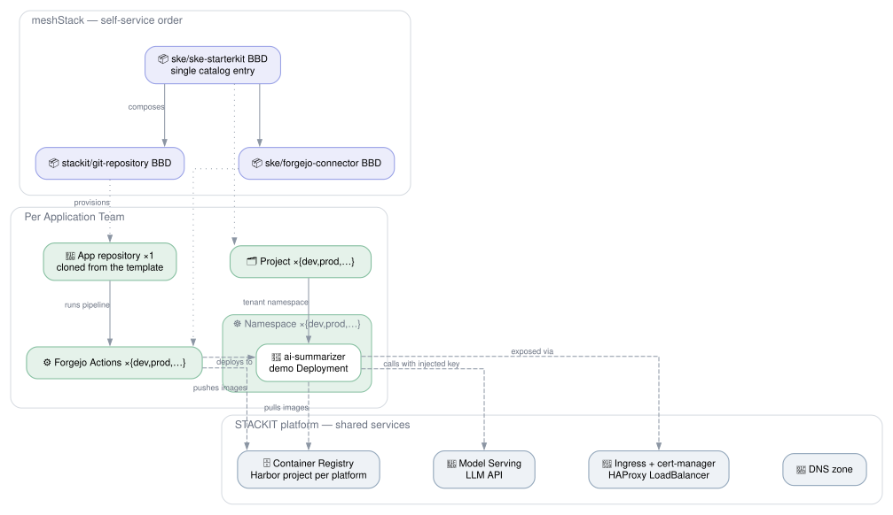

# STACKIT Kubernetes Platform

## Overview

This reference architecture builds a STACKIT Kubernetes Engine (SKE) platform on top of the
STACKIT Landing Zone reference architecture. The SKE platform offers application teams a starter
kit that deploys the ai-summarizer demo app with a dev and a prod stage by default.

Every STACKIT resource is created by a building block that acts as the platform's one STACKIT
service account through workload identity federation. All platform credentials are stored in the
platform's STACKIT Secrets Manager.

## Architecture

### Platform team

The platform team orders the **STACKIT Kubernetes Platform** building block. It creates a
meshProject with a tenant on the STACKIT landing zone, and orders **STACKIT Project** on that tenant
to get the STACKIT project the platform runs in. The diagram below shows the definitions it
registers and what each one provisions in that project:



The same building blocks as a tree, with an arrow from each parent to its child as meshPanel shows
them. The frames show which run orders them:



### Application teams



## How It Works

### Starter kit — `ske/ske-starterkit`

The one definition application teams order. It creates:

1. a Git repository (`stackit/git-repository`), cloned from the template repository, with the
   image name as the `APP_NAME` Actions variable,
2. one meshProject per stage, each with an SKE tenant on that stage's landing zone (`dev` and
   `prod` by default),
3. one Forgejo connector (`ske/forgejo-connector`) per stage,
4. a Project Admin binding on every project for the user who ordered it.

The [Git repository](../../modules/stackit/git-repository) and
[Forgejo connector](../../modules/ske/forgejo-connector) readmes list the secrets, variables and
permissions each one sets up. The connector then triggers the repository's workflow and waits for
it to finish.

## Getting Started

### Prerequisites

| Requirement          | Description |
|----------------------|-------------|
| meshStack instance   | With the OpenTofu IaC runtime. |
| STACKIT Landing Zone | A deployed STACKIT Landing Zone building block. Its summary shows the code block for the **STACKIT Landing Zone** input. |
| STACKIT portal       | Access to the platform's Harbor project, to link one robot account in phase 2. |

### Install

1. Register the definition from `meshstack_integration.tf` in your foundation repository.
2. Order **STACKIT Kubernetes Platform** in the workspace that will own the platform, and paste
   the landing zone's code block into **STACKIT Landing Zone** (see [Landing zone](#landing-zone)).
   Turn **Playground Mode** off for a platform that is used: in playground mode the platform
   identifier gets a random suffix and the STACKIT project is not protected against deletion. It
   cannot be changed after the order.
3. Finish [phase 2](#phase-2-link-the-harbor-robot).

The definition's `display_name_template` names the building block `STACKIT Kubernetes Platform
<platform identifier>` in the order form. A foundation that orders it through the meshStack
provider sets `display_name` to the same string.

The main inputs:

| Input | Purpose |
|---|---|
| STACKIT Landing Zone | The code block from the landing zone's summary; see [Landing zone](#landing-zone) |
| Landing Zone Variant | `default` or `spoke` (needs the `hub&spoke` topology on the landing zone) |
| STACKIT Region | Region of the SKE cluster, `eu01` (default) or `eu02`; fixed at the order. Secrets Manager, Container Registry and AI Model Serving stay in `eu01`, because STACKIT offers them only there. The node pool runs `c3i.2` machines, which both regions offer |
| Platform Identifier | Name of the meshStack platform; the project, cluster, Git instance, registry and DNS zone are named after it |
| Use Global Location | Put the platform into the global meshStack location, on by default; off creates a location for it |
| Playground Mode | Throwaway deployment, on by default; turn it off for a platform that is used; fixed at the order. It hides Starterkit Random Name Suffix (always on), DNS Domain (always `<platform identifier>.stackit.run`) and both approval policies (no gates) |
| Payment Method | One of the workspace's payment methods, for the platform's own project |
| Starter Kit Demo | What the starter kit builds: image `name`, `template_repo` and `ai_model`, `ai-summarizer` from the likvid-bank template on `openai/gpt-oss-120b` by default. Without `ai_model` the platform sets up no Model Serving token and no `stackit-ai` secret |
| Shared PostgreSQL | Optional; see [Shared PostgreSQL](#shared-postgresql) |
| DNS Domain | The platform's DNS zone under a free STACKIT domain (`stackit.run`, `stackit.zone`, `stackit.rocks`, `stackit.gg`, `runs.onstackit.cloud`): a bare one gives `<platform identifier>.stackit.run`, one label more such as `likvid.stackit.run` is the zone itself; `stackit.run` by default |
| Stages | One landing zone per named stage, with stage-specific tags and optional quotas; `dev` and `prod` by default |
| Quota Definitions | The quotas the meshPlatform offers; a stage's `quotas` entry names one by its `quota_key` |
| Tags | Tags as `{key, values}` entries for landing zones, the definitions platform engineers order (`building_block`) and those application teams order (`starterkit_building_block`), the platform's project and the starter kit's projects |
| Approval Policies, Starterkit Approval Policies | See Approval gates |
| Phase 2 Completed | See below |
| Imports | See Adopting Existing Resources |

A tag that a tag policy pairs between a landing zone and a project belongs on both sides, in
`tags.landingzone` and `tags.starterkit_project` or in a stage's `landingzone` and `project`;
otherwise no tenant can be created on the landing zone.

**Overrides** replaces generated values, each optional: `cluster_name`, `cluster_issuer_email` (the
platform's service account by default) and `project_identifier` (`<platform identifier>-ske` by
default). The building block outputs a link to the STACKIT project, the summary of STACKIT
Kubernetes Platform Services and, as `postgres`, the [shared PostgreSQL](#shared-postgresql)
instances.

### Landing zone

The **STACKIT Landing Zone** input is the code block from the
[STACKIT Landing Zone](https://hub.meshcloud.io/reference-architectures/stackit-landingzone)
summary. Copy it again whenever the landing zone's definitions get a new version.

| Key | Used for |
|---|---|
| `platform_ref`, `landingzone_refs` | the tenant of the platform's project, on the landing zone that **Landing Zone Variant** picks |
| `project_bbd_version_ref` | ordering STACKIT Project on the tenant |
| `service_account_bbd_version_ref`, `service_account_federation_bbd_version_ref` | the platform's service account and its federation |

The platform orders STACKIT Project on its tenant, and reads the STACKIT project id from the
tenant's Platform Tenant ID. The block's version is left to the platform team that owns the
definition.

In a workspace other than the landing zone's, these definitions must be published and their
versions released; on the `spoke` variant, the STACKIT Network definition too. The
landing zone README explains
[how](https://hub.meshcloud.io/reference-architectures/stackit-landingzone#other-workspaces).

### Phase 2: link the Harbor robot

Harbor accepts no STACKIT identity until a robot account is linked to it, and only the STACKIT
portal can create that link. The summary lists the steps: create a robot with robot account
management permissions and link it to the platform's service account. Then set **Phase 2
Completed** to true. The next run mints the push and pull robots and registers the **STACKIT Git
Repository**, **SKE Forgejo Connector** and **SKE Starterkit** definitions. The run fails while no
robot is linked.

### Shared PostgreSQL

With the optional **Shared PostgreSQL** input set, the platform registers the instance variant of
[`stackit/postgres`](../../modules/stackit/postgres/buildingblock/README.md) and orders one
instance in its project per key of the input. A key is the name of a stage, its value that
instance's settings, each optional: `replicas` (1 or 3, default 1), `flavor` (`2.4`),
`storage_size_in_gb` (5), `storage_class` (`premium-perf2-stackit`) and `postgres_version` (`17`).
A stage that is no key gets no instance:

```json
{ "dev": {}, "prod": { "replicas": 3 } }
```

The instances are in `eu01`, and only the cluster's egress address ranges may connect. They hold
no database. Databases come from the module's database variant, which a foundation registers once
per landing zone on that stage's instance, as a connector that writes the credentials into the
namespace. The summary and the `postgres` output list the instance IDs, the project and the service
account that definition needs. **Imports** takes over no existing instance.

### Approval gates

The **Approval Policies** input sets which run triggers need an operator's approval on the
platform definitions this architecture registers, **Starterkit Approval Policies** the same for the
Git repository, Forgejo connector and starter kit definitions. The `approval_policies` variable of
`meshstack_integration.tf` sets them for this definition. All default to no gate. A gate switched on
in meshPanel is reset on the next run unless it is set in the input or variable.

### Platform engineer access

The owners and managers of the ordering workspace become Project Admins of the platform's project.
Project Admins join the Forgejo `Owners` team (once they signed in to the Git instance), become
registry admins and get `secrets-manager.reader`, with which they read secrets using their STACKIT
access token:

```sh
export VAULT_ADDR=https://prod.sm.eu01.stackit.cloud
export VAULT_TOKEN=$(stackit auth get-access-token)
vault kv list -mount=<Secrets Manager instance id> <platform identifier>/
```

## Shipping the Starter Kit to Application Teams

The [application-team diagram](#application-teams) shows the three definitions and what an order
creates.

**Who registers it.** The nested **STACKIT Kubernetes Platform Services** run registers the three
definitions in `platform/buildingblock/starterkit.tf`, only once **Phase 2 Completed** is true:
their pipelines push images and their workloads pull them with the robots phase 2 mints. The
**Starter Kit Identity Federation** lets the Git repository runs act as the platform's service
account.

**Where it lives.** All three are owned by the workspace that ordered **STACKIT Kubernetes
Platform**, next to the platform's own definitions. They carry the `starterkit_building_block`
tags and the **Starterkit Approval Policies**.

**When it is released.** `hub.bbd_draft` of this definition decides it, and only for these three.
With `true`, every STACKIT Kubernetes Platform Services run updates their draft version, and only
the owning workspace can order them. Use it to try a Hub ref. With `false`, the run releases them,
and application teams see **SKE Starterkit** in the marketplace. A new Hub ref takes two runs: one
with `true` adds a draft version on top of the released one, one with `false` releases it.
Existing starter kits stay on their version until they are upgraded.

**How an application team orders it.** The team orders **SKE Starterkit** in its own workspace
and gives a project name and a payment method. The run creates what
[Starter kit](#starter-kit--skeske-starterkit) lists. The app is served at `<name>.<DNS zone>` for `prod` and at `<name>-<stage>.<DNS zone>` for the
other stages. The starter kit's summary links each stage and the repository.

## Adopting Existing Resources

The optional **Imports** input takes over resources that already exist, for example a platform
built before this architecture:

| Key | Takes over |
|---|---|
| `project = {admin_bindings}` | the meshProject `overrides.project_identifier` and its tenant on the landing zone platform, renamed to `STACKIT Kubernetes Platform <platform identifier>`; `admin_bindings` maps a username to the name of its existing Project Admin binding |
| `adopt_ske = true` | the SKE cluster `overrides.cluster_name` |
| `git = {instance_id, instance_name, forgejo_organization}` | the STACKIT Git instance and its Forgejo organization |
| `dns = {zone_id, record_set_id}` | the DNS zone **DNS Domain** names and its wildcard record set |
| `adopt_ingress = true` | the namespaces `cert-manager` and `haproxy-ingress`, their Helm releases `cert-manager` and `haproxy`, and the ClusterIssuer `letsencrypt-prod` |
| `secrets_manager = {instance_id}` | the Secrets Manager instance, renamed to the platform identifier |
| `container_registry = {artifactory_id, registry_name}` | the container registry of that full name |
| `kubernetes_platform = {platform_name, location_name, landingzone_names}` | the namespace `meshcloud` and the identities `meshfed-service` and `meshfed-metering` of an earlier meshStack platform registration; `platform_name` also takes over the KUBERNETES meshPlatform of that name, and `landingzone_names` maps a stage to the name of its existing landing zone on it. `location_name` references an existing location instead of creating one; `platform_name` needs it or **Use Global Location**. All three are optional; `{}` takes over only what is in the cluster |
| `starterkit_definitions = {starterkit, git_repository, forgejo_connector}` | the existing definitions application teams order, by uuid, each optional; the platform registers its definition as a new version of each, so their building blocks upgrade to it |

Every key but `starterkit_definitions` needs `project`, because the resources live in its STACKIT project. `adopt_ingress` and
`kubernetes_platform` also need `adopt_ske`. Everything else is created new. Names the imports leave out
derive from **Platform Identifier**, so a stage added later gets `<platform identifier>-namespace-<stage>`.

With `git`, the Git building block's technical user must be in the organization's `Owners` team,
which only an owner can arrange: its first run fails until an owner adds that user, then run it
again.

The order form shows **Imports** only with playground mode off. Through the
API, a playground that takes something over leaves it in place on deletion; otherwise deletion
deletes it. A meshPlatform and definitions can only be taken over with playground mode off.

A definition is taken over in phase 2, when the platform registers it. Its latest version decides
what that run does: a draft version is overwritten, and a released one gets a new draft version
only if `hub.bbd_draft` is true. With `hub.bbd_draft = false` the run fails on a released version, so
take the definitions over with `hub.bbd_draft = true` and release afterwards. Existing building
blocks stay on their version until they are upgraded. Order with **Starterkit Random Name Suffix**
set to what the adopted starterkit used: a starterkit upgrade that changes it renames, and so
replaces, every project and tenant the starterkit created, so it cannot be changed after the order. meshStack checks the Forgejo connector's
`repository_name` input against the latest released Git repository version, so release the Git
repository's new draft by hand before the connector can be saved.

This definition and the platform's own definitions are always drafts, so they stay in the owning
workspace.

The first run may change what it takes over to match this architecture's settings. To review it,
switch on the `building_block_creation` and `any_input_changes` gates in **Approval Policies** for the
adoption and off again afterwards.

## Shared Responsibilities

| Responsibility                                           | Platform Team | Application Team |
|----------------------------------------------------------| --- | --- |
| Provision and manage SKE cluster                         | ✅ | ❌ |
| Configure STACKIT Git (Forgejo) organization             | ✅ | ❌ |
| Manage the Harbor project and its robot accounts         | ✅ | ❌ |
| Register and maintain building block definitions         | ✅ | ❌ |
| Manage STACKIT DNS zone for app hostnames                | ✅ | ❌ |
| Order starterkit from the self-service catalog           | ❌ | ✅ |
| Develop and maintain application source code             | ❌ | ✅ |
| Manage Kubernetes resources inside namespaces            | ❌ | ✅ |
| Maintain Forgejo Actions pipeline (`pipeline.yaml`)      | ❌ | ✅ |
| Monitor application health and logs                      | ❌ | ✅ |
