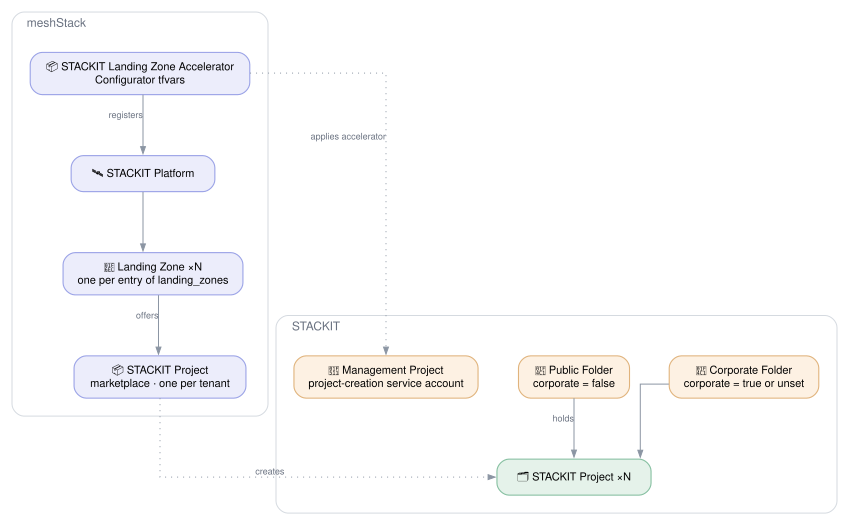

# STACKIT Landing Zone Accelerator

## Overview

The [STACKIT Landing Zone Accelerator](https://github.com/stackitcloud/stackit-landing-zone) builds
a STACKIT foundation: folders, a management project, optional connectivity, DevOps and landing zone
projects. The STACKIT Landing Zone Configurator designs it and exports a tfvars file for the
accelerator's `src/` root.

This reference architecture takes that export as a building block input and applies the
accelerator with exactly these values, except that every folder of the accelerator goes into one
root folder the block creates. The root folder sits where the export's `rm_folder_parent_id` points,
or at the organization root without it, so the export's folder names only need to be unique inside
it. On top of the foundation it registers a STACKIT platform in
meshStack with one landing zone per entry of the export's `landing_zones`:

- Its identifier is `<platform identifier>-<entry key>`, with the key lowercased and every run of
  characters other than letters and digits turned into a dash. For example, the entry `corp-exmpl`
  of platform `web` becomes `web-corp-exmpl`.
- Tenant projects go into the accelerator's corporate folder when the entry's `corporate` is true or
  unset, which is the accelerator's default, and into its public folder when it is false.
- Its display name is the entry's `project_name` with `(corporate)` or `(public)` appended.

An export without landing zones gives a platform without landing zones. Application teams add
**STACKIT Project** from the marketplace to a tenant on one of them, and get a project in that
landing zone's folder.

### Playground Mode

**Playground Mode** deploys a throwaway platform for the deploying workspace. It is off by default
and cannot change after the order.

| | `playground_mode = true` | `playground_mode = false` |
|---|---|---|
| Platform identifier | random suffix appended | taken exactly as given |
| Root folder | `playground-<platform identifier>` | `<platform identifier>` |
| Name of the STACKIT Project definition | ` (<platform identifier>)` appended | the module's name |

A platform identifier is unique across the meshStack instance, so the suffix keeps a playground
from occupying the real name, and the block can be ordered more than once. The export is applied
unchanged in both modes, so the other STACKIT names come from the export. Publish a playground or its
definition only to test that path, and delete it afterwards.

## How It Works

1. The run decodes the pasted export and calls the accelerator's `src/` at the git ref given as
   **Accelerator Version**, such as a release tag. The export's `Accelerator source` header names
   the commit the export was made for. Another ref works when the export's variables fit that
   version.
2. The run creates the root folder, owned by the export's `owner_email`, and the accelerator
   creates its resources in the organization the export names, with its folders in the root
   folder.
3. The run sources `modules/stackit`. It creates the project-creation service account in the
   accelerator's management project, grants it `resource-manager.admin` and `iam.member-admin` on
   the organization, and registers the platform, its landing zones and the STACKIT Project
   definition.

All of this happens in one apply. The run authenticates as the service account whose key is pasted
into **STACKIT Service Account Key**, which meshStack puts into the environment as
`STACKIT_SERVICE_ACCOUNT_KEY`.

The building block state holds the keys of the service accounts the accelerator creates, so restrict
access to it like a secret.

## Limitations

- Projects on a corporate landing zone are created in the corporate folder, but they are not
  attached to the accelerator's network area.
- A meshStack landing zone takes only the folder from its entry. The entry's own project, network,
  roles and services are created once by the accelerator and do not apply to tenant projects.
- The export may not set firewall credentials, `vpn_pre_shared_keys` or `bucket_naming`. A firewall
  needs a second apply after its bootstrap, which this building block does not run.
- Deleting the building block destroys the whole foundation. Delete the tenant projects first.

## Getting Started

### Prerequisites

- A STACKIT organization and a service account that owns it, with a key in JSON format.
- A tfvars file exported from the STACKIT Landing Zone Configurator for that organization.

### Deploy

1. Register the definition from [`meshstack_integration.tf`](meshstack_integration.tf) in the
   workspace that will own the platform.
2. Order it in that workspace. Paste the export into **Landing Zone tfvars**, set **Accelerator
   Version** to a release whose variables fit the export, or to the commit in its `Accelerator
   source` line, paste the service account key and choose a platform identifier. Set the tags
   your meshStack requires on landing zones and building block definitions in **Tags**, as
   `landingzone = [{ key = "...", values = ["..."] }]` and `building_block = [...]`. The variable
   `tags` of `meshstack_integration.tf` pre-fills this input with the same shape.
3. Once the run succeeds, application teams add **STACKIT Project** to their tenants on the new
   landing zones.

## Shared Responsibility

| Responsibility | Platform Team | Application Team |
|---|:---:|:---:|
| Design the landing zone in the Configurator and paste the export | ✅ | ❌ |
| Provide the organization owner service account key | ✅ | ❌ |
| Deploy the accelerator foundation and the STACKIT platform | ✅ | ❌ |
| Add STACKIT Project from the marketplace to their tenants | ❌ | ✅ |
| Manage workloads inside the provisioned STACKIT projects | ❌ | ✅ |
