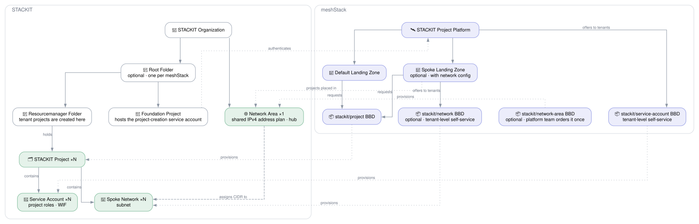

# STACKIT Landing Zone

## Overview

This reference architecture turns a STACKIT organization into a meshStack platform in one run.
Application teams then add **STACKIT Project** from the marketplace to their tenants, and get a
STACKIT project with roles for their project members. Automation, such as a composing architecture,
may order it the same way.

The platform has up to two landing zones:

- **Sandbox** (`<platform identifier>-default`), always. Projects use STACKIT's default flat
  networking.
- **Spoke** (`<platform identifier>-spoke`), with the `hub&spoke` topology. Projects sit in
  a shared hub network area, and each gets a spoke network from the hub's address plan, so no two
  networks overlap.

One STACKIT Project definition serves both. It reads its tenant's landing zone and, on the
spoke one, orders a **STACKIT Network** building block for the project. The
[STACKIT Project readme](../../modules/stackit/project/buildingblock/README.md#landing-zones) has
the details.

## Architecture Diagram

The diagram below shows meshStack on top and STACKIT below. Both landing zones offer the same
STACKIT Project definition (blue). Each STACKIT Project building block creates one project (green)
in the landing-zone folder. On the spoke landing zone, it also orders a STACKIT Network
building block, which takes its subnet from the hub network area. Everything marked *optional*
exists only with the `hub&spoke` topology.



## How It Works

Every run:

1. Creates the **landing-zone folder**, which holds the tenant projects, and the **foundation
   project**, which holds the project-creation service account. [Root Folder](#root-folder) says
   where they go.
2. Registers the STACKIT platform, its landing zones and the STACKIT Project definition through
   [`modules/stackit`](../../modules/stackit). A new platform is hidden in the marketplace, so
   teams add STACKIT Project instead of ordering a bare tenant.
3. Registers [`stackit/service-account`](../../modules/stackit/service-account) and
   [`stackit/service-account-federation`](../../modules/stackit/service-account-federation).

With the `hub&spoke` topology, it also:

4. Registers [`stackit/network-area`](../../modules/stackit/network-area) and orders one building
   block of it in the owning workspace: the hub network area, with the address plan from the
   **Network** input.
5. Adds the spoke landing zone, and registers
   [`stackit/network`](../../modules/stackit/network) for it only.

## Service Accounts

You supply the **deployment service account** as **STACKIT Service Account Key**. It creates the
folders, the foundation project and the meshStack objects. The architecture creates the
**project-creation service account** in the foundation project. It creates the tenant projects and
authenticates through workload identity federation, so no key for it is stored.

**STACKIT Owner Email** owns the folders, the foundation project and every tenant project. STACKIT
sets it at creation only, so changing it later means recreating what it owns. If the deployment
service account is an organization owner, the owner may be any address, typically a team mailbox.
If it only holds `resource-manager.admin`, the owner must be the deployment service account's own
email, or the run fails with `POST /v2/projects/<id>/service-accounts -> 403`.

### Composing architectures

The [STACKIT Kubernetes Platform](https://hub.meshcloud.io/reference-architectures/stackit-kubernetes)
builds on this landing zone. This building block's summary shows a code block to paste into its
**STACKIT Landing Zone** input: the platform and landing zone refs, and the STACKIT Project, STACKIT
Service Account and STACKIT Service Account Federation definitions.

A composing architecture orders STACKIT Project on its tenant, then a service account there with the
roles it needs, then the federation as a child of the account, with its own definitions in
`federated_building_block_definitions`. Runs of those definitions then act as the account through
workload identity federation, and no credential crosses the boundary. A new STACKIT capability
therefore needs only its role in `stackit_assignable_roles` and its definition in
`federated_building_block_definitions`.

### Other workspaces

Another workspace may only order a released definition version that is published to the
marketplace. Deploy with `hub.bbd_draft = false`. Then publish in meshPanel the platform and the
STACKIT Project, STACKIT Service Account and STACKIT Service Account Federation definitions, plus
STACKIT Network with `hub&spoke`.

- A definition's first release waits for a meshStack admin to approve its marketplace review. In a
  workspace without admin rights, the run fails until then; run it again after the approval.
- A new version has a new uuid, so copy the summary block again after the definitions change.
- `hub.bbd_draft` does not apply to this landing zone's own definition, which stays a draft in the
  owning workspace.

## Getting Started

### Prerequisites

| Requirement          | Description                                                                       |
|----------------------|-----------------------------------------------------------------------------------|
| STACKIT organization | A key of the deployment service account, an organization owner. `resource-manager.admin` alone also works, but limits **STACKIT Owner Email**; see [Service Accounts](#service-accounts). |
| CIDR plan            | *(Only with `hub&spoke`)* A non-overlapping IPv4 address plan for the hub network ranges and the transfer network. |

### Deployment Order

Order the **STACKIT Landing Zone** building block once per platform. Its display name is
`STACKIT Landing Zone <platform identifier>`; a foundation that orders it through the meshStack
provider sets `display_name` to the same string.

### Root Folder

One STACKIT organization can serve several meshStacks, for example dev, demo and trial.
**Root Folder Name** then creates a folder at the organization root for everything of this
landing zone:

```
<organization>
└── <root folder name>
    ├── <platform identifier>              tenant projects
    ├── <platform identifier>-foundation
    └── projects of the meshStack that are no tenants
```

Leave it empty for an organization that serves one meshStack. The landing-zone folder then sits at
the organization root and holds the foundation project. The output `root_container_id` is the root
folder, or the organization without one; put other projects of the meshStack there, such as a
metering project. Setting or renaming the root folder later moves the landing-zone folder and the
foundation project in place.

### Tags

meshStack checks its tag definitions and policies when this building block creates the landing
zones and when teams create tenants on them. If your meshStack requires a landing zone tag, or
matches landing zone tags against project tags, set them in **Tags**, as
`landingzone = [{ key = "...", values = ["..."] }]`.

### Playground Mode

**Playground Mode** deploys a throwaway platform for the deploying workspace. It is off by default
and cannot change after the order.

| | `playground_mode = true` | `playground_mode = false` |
|---|---|---|
| Platform identifier | random suffix appended | taken exactly as given |
| Root folder | always, `playground-<platform identifier>` unless named | only when named |
| Folders and foundation project | destroyable | guarded with `prevent_destroy` |
| Names of the registered definitions | ` (<platform identifier>)` appended | the modules' names |

A platform identifier is unique across the meshStack instance, so the suffix keeps a playground
from occupying the real name. Publish a playground or its definitions only to test that path, and
delete it afterwards. STACKIT keeps deleted projects in their folder for up to 7 days, so deleting
a playground fails with a 409 on the folder until then; run the delete again later.

### Adopting an Existing Platform

The optional **Imports** input takes over a STACKIT platform built before this architecture, so
nothing that tenants depend on is replaced. It needs `playground_mode = false`.

| Key | Takes over |
|---|---|
| `folder = {container_id}` | the landing-zone folder, renamed to the platform identifier |
| `foundation_project = {container_id}` | the foundation project, renamed to `<platform identifier>-foundation` |
| `adopt_platform = true` | the location (unless **Use Global Location**), the platform and its landing zones |
| `project_definition = {uuid, service_account_name, service_account_email, federated_identity_provider_ids}` | the STACKIT Project definition and its backplane |
| `service_account_definition = {uuid, service_account_email, federated_identity_provider_ids}` | the STACKIT Service Account definition and its backplane |
| `service_account_federation_definition = {uuid, service_account_email, federated_identity_provider_ids}` | the STACKIT Service Account Federation definition and its backplane |

The three definition keys need `foundation_project`, where their service accounts live. Turn on the
approval gates and approve only a plan that replaces nothing. After the first successful run,
**Imports** can go back to null.

### Approval Gates

The module variable `approval_policies` sets which run triggers need an operator's approval. It
defaults to none.

## Shared Responsibilities

| Responsibility                                                          | Platform Team | Application Team |
|-------------------------------------------------------------------------|:---:|:---:|
| Provide the STACKIT platform and its landing zones                      | ✅ | ❌ |
| Register STACKIT Project and the service account definitions            | ✅ | ❌ |
| *(Optional)* Provide the hub network area and choose its address plan   | ✅ | ❌ |
| Publish the platform and definitions for other workspaces               | ✅ | ❌ |
| Add STACKIT Project to their tenants and pick the landing zone          | ❌ | ✅ |
| Create service accounts inside their STACKIT projects                   | ❌ | ✅ |
| Manage workloads inside their projects                                  | ❌ | ✅ |
